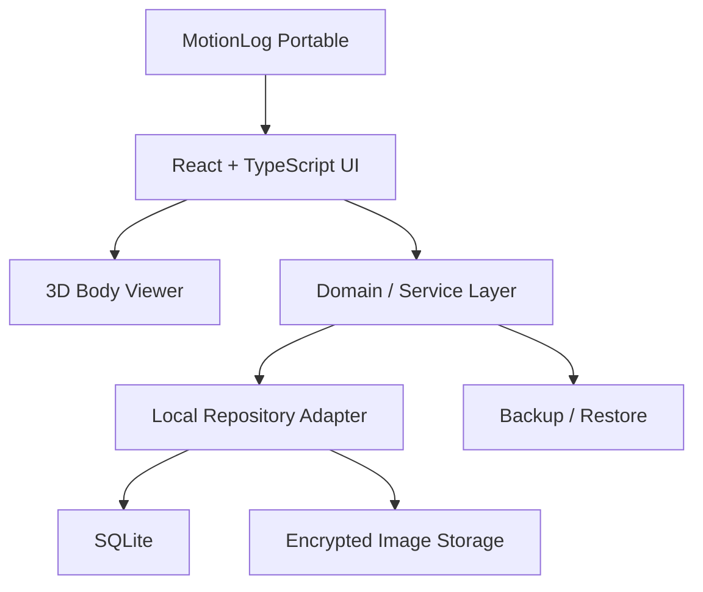
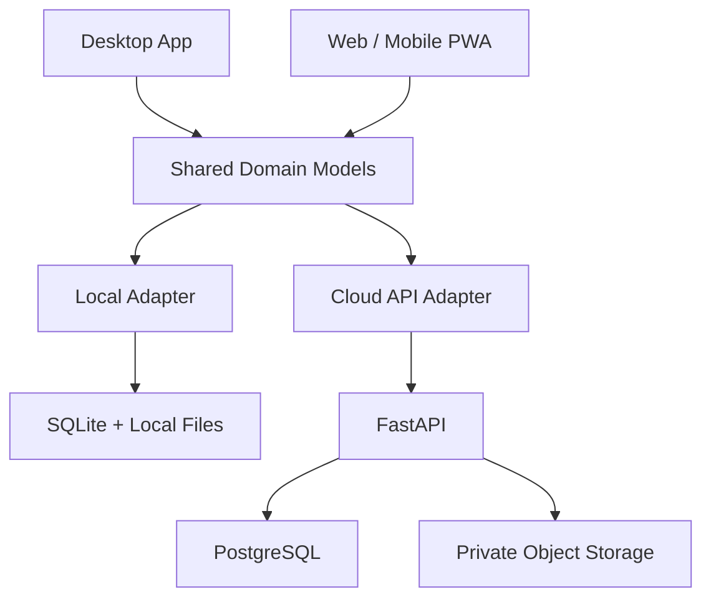

# MotionLog

**MotionLog — Portable Rehabilitation & Body Progress Management System**

> 신체 상태를 기록하고, 재활 과정을 추적하며, 변화를 시각적으로 확인하는 개인용 헬스케어 기록 관리 시스템

## 1. 프로젝트 개요

MotionLog는 신체 상태 평가, 운동 지도, 재활 경과 및 변화 기록을 체계적으로 관리하기 위한 프로그램이다.

대상자별 신체 사진, 증상, 운동 지도 내용, 3D 인체 모형의 신체 부위 표시, 회차별 변화 기록 등을 하나의 인터페이스에서 관리한다.

초기에는 별도의 서버나 인터넷 연결 없이 사용할 수 있는 **Windows USB Portable 프로그램**으로 개발한다.

장기적으로는 기존 데이터를 유지하면서 웹 및 모바일 환경으로 확장하는 것을 목표로 한다.

### 프로젝트 기본 정보

| 항목 | 내용 |
|---|---|
| 프로젝트명 | MotionLog |
| 프로젝트 유형 | 개인용 신체 상태·재활 경과 기록 관리 |
| 초기 플랫폼 | Windows USB Portable |
| 향후 플랫폼 | Web / Mobile PWA |
| 초기 운영 방식 | Offline / Local-first |
| 서버 | 초기 버전 불필요 |
| 데이터베이스 | SQLite |
| 이미지 저장 | USB 내부 암호화 파일 저장소 |
| 주요 기능 | 대상자 관리, 3D 인체 기록, 사진 비교, 재활 일지 |
| 개발 언어 | TypeScript, Rust |
| UI 프레임워크 | React |
| 데스크톱 프레임워크 | Tauri 2 |
| 3D 엔진 | Three.js / React Three Fiber |
| 향후 백엔드 | Python FastAPI |
| 향후 DB | PostgreSQL |
| 향후 파일 저장소 | Private Object Storage |
| 개발 버전 정책 | 0.0.x → 0.1.0 → 0.x.x |

---

## 2. 프로젝트 목표

### 2.1 핵심 목표

- 신체 상태와 재활 경과를 쉽고 빠르게 기록한다.
- 대상자별 사진과 증상 기록을 통합 관리한다.
- 3D 인체 모형에서 신체 부위를 직접 선택한다.
- 선택한 부위에 증상, 통증 점수, 운동 지도 내용을 연결한다.
- 동일 부위의 이전 기록과 최신 기록을 비교한다.
- 인터넷 없이 USB만으로 프로그램과 데이터를 사용한다.
- 기존 데이터를 유지하면서 프로그램을 업데이트한다.
- 향후 웹 서버로 데이터 이전 및 동기화할 수 있도록 설계한다.

### 2.2 개발 원칙

1. **Simplicity** — 설명 없이 사용할 수 있는 직관적인 UI
2. **Portable** — USB를 통해 여러 Windows PC에서 실행
3. **Offline-first** — 인터넷 연결 없이 주요 기능 사용
4. **Data Ownership** — 사용자가 자신의 데이터를 관리
5. **Privacy by Design** — 개인정보 보호를 기본 설계에 반영
6. **Cloud-ready** — 웹 서비스 전환을 고려한 데이터 모델
7. **Backward Compatibility** — 업데이트 시 기존 데이터 호환성 유지
8. **Modular Architecture** — UI, 도메인, 저장소 구현 분리

---

## 3. 초기 배포 방식

### 3.1 USB Portable

초기 MotionLog는 별도의 설치 과정 없이 USB에서 실행할 수 있는 Windows 프로그램을 목표로 한다.

사용 흐름:

1. USB를 Windows PC에 연결한다.
2. USB 내부의 `MotionLog.exe`를 실행한다.
3. 사용자 인증 후 기존 데이터를 불러온다.
4. 대상자를 선택하고 기록을 조회하거나 추가한다.
5. 변경된 기록을 USB 내부에 저장한다.
6. 프로그램을 정상 종료한 뒤 USB를 안전하게 제거한다.

다른 Windows PC에서도 동일한 USB를 연결하면 기존 기록을 이어서 사용할 수 있도록 한다.

단, Windows 보안 정책과 WebView2 런타임 등 실행 환경에 따라 추가 구성요소가 필요할 수 있다. 따라서 **별도 설치 없는 실행은 목표이며, 모든 Windows PC에서 무조건 실행되는 것을 보장하지 않는다.**

### 3.2 Portable 디렉터리 구조

```text
MotionLog/
├── MotionLog.exe
├── app/
│   ├── assets/
│   └── models/
│       └── human-body.glb
├── data/
│   └── motionlog.db
├── images/
│   └── {client_id}/
│       └── {session_id}/
│           └── {photo_id}.enc
├── backups/
├── config/
│   └── settings.json
└── logs/
```

설계 원칙:

- USB 드라이브 문자에 의존하지 않는다.
- 프로그램 실행 경로를 기준으로 데이터 저장소를 탐색한다.
- 절대 경로 대신 상대 경로와 논리적 파일 ID를 사용한다.
- 실행 파일과 사용자 데이터를 분리한다.
- 프로그램 업데이트 시 기존 데이터를 덮어쓰지 않는다.
- 프로그램 설정과 사용자 데이터를 독립적으로 관리한다.
- 데이터 암호화 키를 USB 내부에 평문으로 저장하지 않는다.
- USB 제거 및 저장 중단으로 인한 데이터 손상을 방지한다.

---

## 4. 시스템 아키텍처

### 4.1 초기 Local-first 아키텍처



### 4.2 향후 Cloud-ready 아키텍처



초기에는 로컬 저장소를 사용하고, 웹 전환 시 Cloud Adapter를 추가한다.

화면 컴포넌트가 SQLite나 로컬 파일 경로에 직접 의존하지 않도록 구성한다.

---

## 5. 기술 스택

### 5.1 초기 Desktop

| 영역 | 기술 | 역할 |
|---|---|---|
| Desktop | Tauri 2 | Windows Portable 실행 |
| Frontend | React + TypeScript | UI 및 사용자 인터랙션 |
| Build | Vite | 프론트엔드 개발 및 빌드 |
| Styling | Tailwind CSS | 반응형 UI |
| UI Components | shadcn/ui | 공통 컴포넌트 |
| 3D | Three.js | 인체 모형 렌더링 |
| React 3D | React Three Fiber | 3D React 통합 |
| 3D Format | GLB / glTF | 인체 모델 |
| Database | SQLite | 대상자 및 재활 기록 |
| Image Storage | Encrypted Local Files | 신체 사진 저장 |
| Validation | Zod | 입력 데이터 검증 |
| Testing | Vitest / Playwright | 기능 및 UI 테스트 |

### 5.2 향후 Web

| 영역 | 기술 |
|---|---|
| Web | React 기반 PWA |
| Backend | FastAPI |
| Database | PostgreSQL |
| Authentication | 서버 기반 인증 |
| File Storage | Private Object Storage |
| API | REST API |
| Synchronization | 버전 관리 및 충돌 처리 기반 동기화 |

향후 기술 스택은 실제 요구사항과 운영 환경에 따라 변경할 수 있다.

---

## 6. 핵심 기능

### 6.1 대상자 관리

- 대상자 등록·수정·삭제
- 대상자 검색
- 대상자별 기록 조회
- 최초 등록일 및 최근 방문일
- 회차별 재활 이력
- 신체 사진 연결
- 개인정보 수집 및 촬영 동의 관리

### 6.2 3D 인체 모형

MotionLog의 핵심 인터페이스다.

기본 기능:

- 3D 인체 모형 표시
- 정면·후면·좌측·우측 회전
- 확대·축소
- 신체 부위 터치 및 클릭
- 선택 부위 강조
- 신체 마커 추가·수정·삭제
- 여러 부위 동시 기록
- 기존 마커 불러오기
- 신체 부위별 과거 기록 조회

#### 신체 부위 선택 방식

초기에는 부위별 선택과 좌표 기반 선택을 함께 지원한다.

예시:

- 왼쪽 어깨
- 오른쪽 어깨
- 목
- 등
- 허리
- 골반
- 팔꿈치
- 손목
- 무릎
- 발목

#### 마커 유형

| 유형 | 의미 |
|---|---|
| Pain | 통증 |
| Stiffness | 근육 긴장 및 뻣뻣함 |
| Mobility | 움직임 제한 |
| Observation | 관찰 및 평가 |
| Improvement | 호전 상태 기록 |

색상과 텍스트를 함께 사용하여 상태를 구분한다.

#### 3D 좌표 보존

신체 마커에는 다음 정보를 저장한다.

```json
{
  "id": "marker-uuid",
  "region_code": "RIGHT_SHOULDER",
  "model_version": "human-v1",
  "mesh_name": "upper_body",
  "position": {
    "x": 0.42,
    "y": 1.35,
    "z": 0.18
  },
  "marker_type": "pain",
  "pain_score": 4
}
```

3D 모델 변경 시 기존 좌표를 복원할 수 있도록 모델 버전과 Mesh 정보를 보존한다.

### 6.3 신체 사진 기록

- 사진 업로드
- 대상자 및 회차 연결
- 촬영일 자동 기록
- 정면·측면·후면 구분
- 신체 부위 연결
- 원본 보존
- 썸네일 생성
- 사진별 메모
- 사진 삭제 및 복구 정책

### 6.4 Before / After 비교

- 초기 사진과 최신 사진 비교
- 좌우 분할 비교
- 슬라이더 비교
- 투명도 오버레이
- 촬영 날짜 및 회차 표시
- 동일 부위 사진 필터링
- 사진 확대·축소
- 변화 관찰 메모

사진만으로 의학적 회복을 자동 판정하지 않으며, 통증 점수와 기능 평가 등 다른 기록을 함께 참고한다.

### 6.5 재활 및 상태 기록

- 방문 회차 관리
- 통증 부위 선택
- 통증 점수 0~10
- 증상 유형
- 운동 및 재활 지도 내용
- 관절 가동범위 기록
- 변화 관찰 내용
- 다음 방문 시 확인할 사항
- 기록 작성·수정·삭제

### 6.6 경과 관리

- 회차별 타임라인
- 통증 점수 변화 그래프
- 부위별 증상 변화
- 사진 변화 비교
- 3D 마커 변화
- 최근 기록 요약
- 대상자별 전체 기록 검색

### 6.7 사례 학습

향후 비식별 사례를 학습 자료로 활용할 수 있도록 구성한다.

- 사례별 분류
- 신체 부위별 검색
- 증상별 검색
- 재활 지도 방식별 검색
- 경과 비교
- 개인 학습 메모

학습용 자료 생성 시 개인정보를 비식별 처리하고, 원래 수집 목적과 별도의 활용에 필요한 법적 요건 및 동의를 검토한다.

---

## 7. UI / UX 설계

### 7.1 디자인 목표

**전문적인 헬스케어 관리 프로그램의 신뢰감과 일반 메모 앱의 간편함을 결합한다.**

UI는 다음 원칙을 따른다.

- 직관적인 메뉴
- 최소한의 클릭
- 불필요한 팝업 제거
- 충분한 여백
- 명확한 버튼과 아이콘
- 높은 가독성
- 일관된 디자인
- 상태 자동 표시
- 자동 날짜 및 회차 입력
- PC 및 모바일 반응형 구성

### 7.2 디자인 시스템

| 항목 | 기준 |
|---|---|
| 기본 테마 | Light |
| 배경 | White / Light Gray |
| 강조 색상 | Teal |
| 기본 글꼴 | Pretendard |
| 기본 글자 크기 | 14~16px |
| UI | Minimal / Clean |
| 아이콘 | Lucide |
| 버튼 | 텍스트 + 아이콘 |
| 반응형 | Desktop / Tablet / Mobile |
| Dark Mode | 향후 지원 |

### 7.3 주요 화면

#### Dashboard

- 최근 대상자
- 최근 기록
- 빠른 기록 작성
- 대상자 검색
- 전체 기록 조회

#### Client Detail

- 대상자 기본 정보
- 3D 인체 모형
- 선택 부위 상태
- 최근 기록
- 사진
- 회차별 타임라인

#### Assessment

- 3D 신체 부위 선택
- 증상 선택
- 통증 점수
- 운동 지도 내용
- 사진 첨부
- 기록 저장

#### Progress Comparison

- Before / After
- 날짜별 사진
- 부위별 변화
- 통증 변화 그래프

#### Settings

- 데이터 저장 위치
- 백업 및 복원
- 암호화 및 인증 설정
- 프로그램 정보
- 데이터 내보내기
- 향후 서버 연결 설정

### 7.4 사용자 작업 흐름

```text
프로그램 실행
    ↓
사용자 인증
    ↓
대상자 선택
    ↓
3D 인체 모형에서 신체 부위 선택
    ↓
기존 기록 확인
    ↓
새 기록 작성
    ↓
사진 첨부
    ↓
저장
```

기록 과정에서 불필요한 화면 전환을 최소화한다.

---

## 8. 데이터베이스 설계

### 8.1 SQLite

초기에는 SQLite를 사용한다.

SQLite에는 이미지 바이너리 대신 사진 메타데이터와 파일 식별자를 저장한다.

### 8.2 주요 테이블

| 테이블 | 설명 |
|---|---|
| `clients` | 대상자 정보 |
| `sessions` | 방문 및 재활 회차 |
| `body_regions` | 신체 부위 마스터 |
| `body_markers` | 3D 인체 마커 및 좌표 |
| `assessment_records` | 증상 및 평가 기록 |
| `treatment_records` | 운동·재활 지도 내용 |
| `progress_photos` | 사진 메타데이터 |
| `consent_records` | 개인정보 및 촬영 동의 기록 |
| `audit_logs` | 데이터 접근 및 변경 이력 |
| `schema_migrations` | DB 스키마 변경 이력 |

### 8.3 데이터 설계 원칙

- UUID 기반 고유 ID
- UTC 기준 날짜 저장
- SQLite / PostgreSQL 공통 논리 스키마
- 외래 키를 통한 참조 무결성
- 데이터 생성·수정 시각 기록
- 스키마 마이그레이션 지원
- 이미지 파일 ID와 DB 레코드 연결
- 3D 모델 버전 관리
- 삭제 정책 및 변경 이력 관리

---

## 9. 이미지 저장소

### 9.1 기본 정책

실제 이미지는 USB 내부의 암호화된 파일 저장소에 보관한다.

SQLite에는 다음 메타데이터를 저장한다.

- 이미지 UUID
- 대상자 UUID
- 회차 UUID
- 저장소 키
- MIME Type
- 파일 크기
- SHA-256 체크섬
- 촬영일
- 등록일
- 촬영 방향
- 연결된 신체 부위

### 9.2 파일 저장 원칙

- 절대 경로 사용 금지
- 원본 사진 보존
- 암호화 저장
- 썸네일 분리 관리
- 이미지 무결성 검증
- 파일 중복 관리
- DB와 이미지 간 참조 무결성 검사

### 9.3 GitHub 저장소 정책

GitHub는 프로그램 소스코드 및 개발 문서 관리에 사용한다.

실제 대상자 사진, 운영 DB, 백업 파일은 GitHub에 Commit하지 않는다.

---

## 10. 보안 및 개인정보 보호

신체 사진과 건강 관련 기록은 민감한 개인정보가 될 수 있다.

따라서 초기 로컬 버전부터 보안을 고려한다.

### 필수 보안 요구사항

- 프로그램 실행 시 사용자 인증
- DB 및 이미지 암호화
- 암호화 키 안전 관리
- 개인정보 수집 및 촬영 동의 관리
- 데이터 접근 권한 제한
- 삭제 및 보관 기간 정책
- 암호화 백업
- 데이터 무결성 검사
- 민감정보 로그 출력 금지
- 실제 대상자 데이터를 이용한 테스트 제한

### USB 보안

- USB 분실 대비 암호화
- 비밀번호 기반 잠금
- 비밀번호 오류 처리
- 안전한 프로그램 종료
- 저장 완료 여부 표시
- USB 강제 제거 시 데이터 손상 대응
- 별도 저장장치에 암호화 백업

### 데이터 사용 원칙

실제 대상자 정보를 사용하기 전 개인정보보호법, 민감정보 처리, 개인정보 처리 위탁 및 관련 법적 요건을 검토한다.

의료행위에 해당하는 진단이나 처방을 자동 수행하는 시스템으로 설계하지 않는다.

---

## 11. 백업 및 복원

USB 하나에 모든 데이터를 저장하는 것은 위험하므로 별도의 백업 기능을 제공한다.

### 백업 대상

- SQLite DB
- 사진 원본
- 썸네일
- 3D 마커
- 재활 기록
- 설정 및 스키마 버전

### 백업 정책

- 암호화 백업 파일 생성
- 백업 파일 무결성 검증
- 백업 생성일 기록
- 백업 파일 별도 저장
- 복원 전 기존 데이터 보호
- 복원 실패 시 기존 상태 유지

백업은 SQLite의 일관된 스냅샷과 첨부파일을 하나의 논리적 시점으로 묶어 생성해야 한다.

단순히 실행 중인 DB 파일을 복사하는 방식은 사용하지 않는다.

---

## 12. 향후 웹 전환

### 12.1 목표

USB Portable에서 생성한 모든 기록을 웹 환경에서도 사용할 수 있도록 한다.

### 12.2 데이터 이전

```text
USB Portable
    ↓
SQLite + Encrypted Images
    ↓
Encrypted Export Package
    ↓
Migration / Validation
    ↓
FastAPI
    ├── PostgreSQL
    └── Private Object Storage
    ↓
Web / Mobile PWA
```

### 12.3 이전 대상

- 대상자 정보
- 방문 및 회차 기록
- 신체 부위 정보
- 3D 마커 좌표
- 사진 원본
- 증상 및 통증 기록
- 운동 지도 이력
- 경과 데이터

### 12.4 이전 검증

- 대상자 수 비교
- 기록 수 비교
- 이미지 수 비교
- 이미지 체크섬 검증
- 3D 마커 복원 검증
- 관계 데이터 검증
- 중복 데이터 처리
- 실패 시 롤백

### 12.5 동기화

초기 웹 전환에서는 일회성 데이터 이전을 우선한다.

향후 Desktop과 Web을 동시에 사용할 필요가 생기면 양방향 동기화를 개발한다.

동기화에는 변경 이력, 충돌 처리, 삭제 전파, 인증 및 권한 검증을 포함한다.

---

## 13. 프로젝트 소스 구조

```text
MotionLog/
├── apps/
│   ├── desktop/
│   │   ├── src/
│   │   └── src-tauri/
│   ├── web/
│   └── api/
├── packages/
│   ├── ui/
│   ├── domain/
│   ├── body-3d/
│   ├── data-contracts/
│   └── validation/
├── database/
│   ├── sqlite/
│   ├── postgres/
│   └── migrations/
├── assets/
│   └── models/
├── docs/
│   ├── ARCHITECTURE.md
│   ├── DATA_SCHEMA.md
│   ├── SECURITY.md
│   ├── PORTABLE_DESIGN.md
│   ├── MIGRATION_PLAN.md
│   ├── UI_UX_GUIDELINES.md
│   ├── TEST_PLAN.md
│   └── IMPLEMENTATION_ROADMAP.md
├── tests/
├── README.md
└── .gitignore
```

향후 사용 예정인 디렉터리는 개발 단계에 맞춰 생성한다.

---

## 14. 개발 로드맵

### Phase 1 — 기반 설계

#### v0.0.1 — Project Foundation

- [ ] Tauri 2 프로젝트 초기화
- [ ] React + TypeScript 구성
- [ ] Tailwind CSS 구성
- [ ] 공통 프로젝트 디렉터리 구성
- [ ] 공통 도메인 모델 정의
- [ ] 데이터 저장소 인터페이스 정의
- [ ] USB 상대 경로 처리 설계
- [ ] 기본 UI 레이아웃 구현
- [ ] 개발 환경 및 빌드 검증

#### v0.0.2 — Portable Foundation

- [ ] Windows Portable 실행 구조
- [ ] 실행 파일 기준 데이터 경로 탐색
- [ ] SQLite 초기화
- [ ] 데이터 디렉터리 자동 생성
- [ ] 프로그램 설정 관리
- [ ] USB 실행 환경 검증
- [ ] Windows WebView2 의존성 검증

### Phase 2 — 핵심 기능

#### v0.0.3 — Client Management

- [ ] 대상자 등록
- [ ] 대상자 수정 및 조회
- [ ] 대상자 검색
- [ ] 대상자별 상세 화면
- [ ] SQLite 데이터 저장
- [ ] 개인정보 동의 상태 관리

#### v0.0.4 — 3D Body Viewer

- [ ] GLB 인체 모델 로딩
- [ ] 3D 회전 및 확대·축소
- [ ] 정면·후면 전환
- [ ] 신체 부위별 Mesh 매핑
- [ ] 신체 부위 선택
- [ ] 선택 부위 강조 표시
- [ ] 3D 렌더링 성능 검증

#### v0.0.5 — Body Marker Management

- [ ] 신체 마커 추가
- [ ] 마커 위치 저장
- [ ] 부위별 증상 기록
- [ ] 통증 점수 입력
- [ ] 기존 마커 불러오기
- [ ] 마커 수정 및 삭제
- [ ] 모델 버전 및 좌표 관리

#### v0.0.6 — Photo Management

- [ ] 이미지 첨부
- [ ] 이미지 암호화 저장
- [ ] 사진 메타데이터 DB 저장
- [ ] 대상자 및 회차 연결
- [ ] 썸네일 생성
- [ ] 사진 조회
- [ ] 이미지 무결성 검사

### Phase 3 — 경과 관리

#### v0.0.7 — Progress Tracking

- [ ] 방문 회차 관리
- [ ] 재활 및 운동 지도 기록
- [ ] 회차별 타임라인
- [ ] 통증 변화 그래프
- [ ] 부위별 기록 검색
- [ ] 최근 기록 요약

#### v0.0.8 — Before / After

- [ ] 사진 좌우 비교
- [ ] 비교 슬라이더
- [ ] 투명도 오버레이
- [ ] 촬영 방향별 필터링
- [ ] 날짜 및 회차 비교
- [ ] 3D 마커 경과 비교

### Phase 4 — 안정화

#### v0.0.9 — Security & Portable Release

- [ ] 사용자 인증
- [ ] 암호화 키 관리
- [ ] DB 및 사진 보호 검증
- [ ] 백업 및 복원
- [ ] 데이터 내보내기·가져오기
- [ ] SQLite 무결성 검사
- [ ] USB 강제 제거 테스트
- [ ] 다른 Windows PC 실행 테스트
- [ ] 설치 불필요 실행 검증
- [ ] 프로그램 업데이트 시 데이터 보존 검증

#### v0.1.0 — Portable MVP

- [ ] Windows Portable 배포 패키지
- [ ] 주요 기능 통합 테스트
- [ ] 사용자 흐름 검증
- [ ] UI / UX 검수
- [ ] 보안 검수
- [ ] 백업 및 복원 검증
- [ ] 기존 데이터 호환성 검증
- [ ] 릴리스 문서 작성

### Phase 5 — Web Migration

#### v0.2.x — Cloud Backend

- [ ] FastAPI 서버
- [ ] PostgreSQL
- [ ] Private Object Storage
- [ ] 인증 및 접근 제어
- [ ] SQLite → PostgreSQL 데이터 이전
- [ ] 이미지 업로드 및 마이그레이션
- [ ] 데이터 무결성 검증

#### v0.3.x — Web / Mobile

- [ ] 웹 인터페이스
- [ ] 모바일 PWA
- [ ] 공통 UI 재사용
- [ ] 모바일 사진 촬영
- [ ] 3D 신체 모형 모바일 최적화
- [ ] 원격 기록 조회 및 관리

#### v0.4.x — Synchronization

- [ ] Desktop / Web 동기화
- [ ] 변경 이력 관리
- [ ] 충돌 해결
- [ ] 삭제 동기화
- [ ] 오프라인 변경사항 동기화
- [ ] 동기화 상태 및 오류 표시

---

## 15. 테스트 및 품질 기준

### 기능 테스트

- [ ] 대상자 등록 및 조회
- [ ] 3D 모델 정상 표시
- [ ] 신체 부위 선택
- [ ] 마커 저장 및 복원
- [ ] 사진 저장 및 조회
- [ ] 재활 기록 저장
- [ ] Before / After 비교
- [ ] 경과 데이터 조회

### Portable 테스트

- [ ] USB 드라이브 문자 변경
- [ ] 다른 Windows PC 실행
- [ ] 인터넷 차단 환경 실행
- [ ] 데이터 경로 자동 인식
- [ ] 프로그램 재실행 후 기록 유지
- [ ] 프로그램 업데이트 후 데이터 유지
- [ ] USB 저장 공간 부족 처리
- [ ] 저장 중 USB 제거 대응

### 데이터 테스트

- [ ] DB 무결성
- [ ] 이미지 체크섬
- [ ] UUID 중복 방지
- [ ] 외래 키 무결성
- [ ] 스키마 마이그레이션
- [ ] 백업 및 복원
- [ ] 웹 이전 시 데이터 보존

### UI / UX 테스트

- [ ] 주요 기능 접근성
- [ ] 글자 및 버튼 가독성
- [ ] 불필요한 화면 전환 최소화
- [ ] 작은 화면 대응
- [ ] 3D 조작 편의성
- [ ] 저장 상태 표시
- [ ] 오류 메시지 명확성

---

## 16. 개발 및 배포 정책

### 버전 관리

초기 개발 단계에서는 `0.0.x` 형식으로 마지막 버전 번호를 증가시킨다.

- `0.0.x` — 초기 개발
- `0.1.0` — Portable MVP
- `0.2.x` — 서버 및 데이터 이전
- `0.3.x` — Web / Mobile
- `0.4.x` — 동기화

### 업데이트 원칙

- 이전 버전 기능 유지
- 기존 데이터 삭제 금지
- 스키마 변경 시 마이그레이션 제공
- 변경사항 문서화
- 버전별 테스트 결과 기록
- 기존 계획 변경 시 변경 사유 기록
- 보안 및 데이터 무결성 검증 후 배포

### 개발 문서 관리

모든 버전은 다음 문서를 기준으로 관리한다.

- `README.md` — 프로젝트 소개 및 전체 계획
- `docs/ARCHITECTURE.md` — 시스템 아키텍처
- `docs/DATA_SCHEMA.md` — 데이터 구조
- `docs/SECURITY.md` — 보안 정책
- `docs/PORTABLE_DESIGN.md` — USB Portable 설계
- `docs/MIGRATION_PLAN.md` — 웹 이전 계획
- `docs/IMPLEMENTATION_ROADMAP.md` — 버전별 진행 현황

### 릴리스 산출물

각 개발 버전에서 다음 내용을 제공한다.

- 실행 가능한 프로젝트 소스
- 변경사항 및 구현 기능
- 실행 및 빌드 방법
- 테스트 방법과 결과
- 알려진 문제
- 다음 버전 개발 체크리스트

---

## 17. 향후 확장 아이디어

- AI 기반 자세 변화 분석 보조
- 신체 랜드마크 측정
- 관절 가동범위 측정 보조
- 근육·뼈·관절별 3D 레이어
- 신체 부위별 재활 이력 시각화
- QR 코드 기반 모바일 사진 촬영
- 음성 메모 및 텍스트 변환
- 비식별 사례 학습 라이브러리
- 보고서 PDF 생성
- 웹 기반 다중 사용자 관리
- Desktop / Web 자동 동기화

AI 분석 결과는 전문가의 판단을 보조하는 참고 정보로 제공하며, 의료적 진단을 자동 확정하는 기능으로 사용하지 않는다.

---

## 18. 현재 프로젝트 상태

**Current Stage: Planning / Architecture Design**

| 항목 | 상태 |
|---|---|
| 프로젝트명 | 확정 |
| USB Portable 방향 | 확정 |
| Local-first 아키텍처 | 설계 방향 확정 |
| SQLite | 선정 |
| 이미지 저장 방식 | 선정 |
| 3D 인체 기록 | 요구사항 정의 |
| UI / UX 방향 | 요구사항 정의 |
| 보안 정책 | 기본 원칙 정의 |
| 웹 전환 전략 | 설계 방향 확정 |
| 프로젝트 코드 | 미구현 |
| Windows 실행 파일 | 미생성 |
| 실제 기능 테스트 | 미진행 |

현재 README는 개발 계획 및 설계 기준을 정리한 문서이며, 기능 구현이나 테스트가 완료되었다는 의미는 아니다.

---

## 19. 최종 목표

MotionLog의 최종 목표는 단순한 신체 사진 보관 프로그램이 아니다.

**신체 상태를 시각적으로 기록하고, 재활 및 운동 지도 과정을 체계적으로 관리하며, 시간에 따른 변화를 확인할 수 있는 개인용 헬스케어 기록 플랫폼**을 구축하는 것이다.

초기에는 USB 하나로 실행할 수 있는 간편하고 안전한 프로그램을 완성한다.

이후 기존 데이터를 보존하면서 웹·모바일 서비스로 발전시키는 것을 장기적인 목표로 한다.

**MotionLog — Track Movement. Record Progress.**
